# Module 4 · TaskFlow API: Dockerize & Deploy

The Module 3 TaskFlow API is packaged in Docker, deployed to Render, and verified live. All five stretch goals are also complete: a CI pipeline, a Netlify frontend, the Simple CRM project, versioned Docker images and security checks.

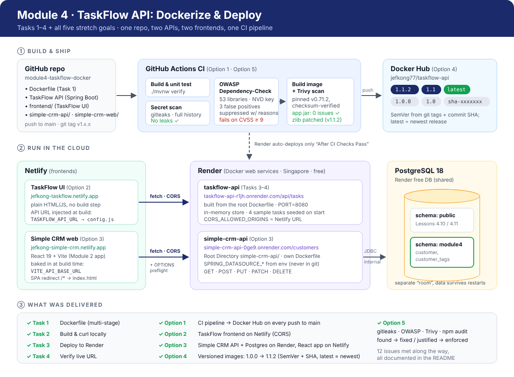

> The infographic is also available as a scalable [SVG](docs/infographic.svg).

## Live links

| What | URL |
|---|---|
| **TaskFlow API (Tasks 3–4)** | **https://taskflow-api-r1jh.onrender.com/api/tasks** |
| TaskFlow frontend (Option 2) | https://jefkong-taskflow.netlify.app |
| Simple CRM API (Option 3) | https://simple-crm-api-0ge9.onrender.com/customers |
| Simple CRM frontend (Option 3) | https://jefkong-simple-crm.netlify.app (demo login: `jialat007@tamjiak.com` / `password321`) |
| Docker Hub image (Options 1 & 4) | https://hub.docker.com/r/jefkong77/taskflow-api/tags |
| Successful CI run, v1.0.0 (Option 1) | https://github.com/Jefkong77/module4-taskflow-docker/actions/runs/42369994513 |
| Successful CI run, v1.1.2 (Options 1, 4 & 5) | https://github.com/Jefkong77/module4-taskflow-docker/actions/runs/42387516292 |

> **First load can take up to a minute.** Render's free services go to sleep after 15 minutes without traffic, so the first request wakes them up.

## Summary

| | Item | Status | Evidence |
|---|---|---|---|
| Task 1 | Create Dockerfile | ✅ Done | [Dockerfile](Dockerfile) |
| Task 2 | Build and test the image locally | ✅ Done | [Screenshots](#task-2--build-and-test-the-image-locally) |
| Task 3 | Deploy to Render | ✅ Done | [Screenshots](#task-3--deploy-to-render) |
| Task 4 | Verify the deployment | ✅ Done | [Screenshots](#task-4--verify-the-deployment) |
| Option 1 | CI pipeline to Docker Hub | ✅ Done | [Details](#option-1--ci-pipeline-github-actions--docker-hub) |
| Option 2 | Frontend on Netlify | ✅ Done | [Details](#option-2--taskflow-frontend-on-netlify) |
| Option 3 | Simple CRM API + React app | ✅ Done | [Details](#option-3--simple-crm-project-render--postgresql--netlify) |
| Option 4 | Versioned Docker images (1.0.0, 1.1.2) | ✅ Done | [Details](#option-4--versioned-docker-images) |
| Option 5 | Security checks | ✅ Done | [Details](#option-5--security-checks) |

Each section below follows the same pattern: **What** I did, **Why** it matters, and **Take note**, the important details and lessons.

---

## Task 1 · Create the Dockerfile

**What:** I added the assignment's multi-stage [`Dockerfile`](Dockerfile) to the repo root:

- **Stage 1** uses `maven:3.9-eclipse-temurin-21` to build the JAR.
- **Stage 2** copies only that JAR into the much smaller `eclipse-temurin:21-jre-alpine` runtime image.

**Why:** A multi-stage build keeps Maven, the source code and the build cache out of the final image. The result is smaller, faster to deploy, and exposes less to attackers.

**Take note:**
- Tag [`v1.0.0`](https://github.com/Jefkong77/module4-taskflow-docker/tree/v1.0.0) contains the Dockerfile **exactly as given in the assignment**.
- After a Trivy scan I added one security line (`apk upgrade zlib`), first released in **v1.1.2**. See [Option 5](#option-5--security-checks).
- A [`.dockerignore`](.dockerignore) keeps `target/`, `.git/`, the frontends and the docs out of the build context.

Two small changes to the Module 3 code made it suitable for the cloud:

| Change | Why |
|---|---|
| `OPENAI_API_KEY` now has a default value | The Module 3 config *required* the key, so the container would crash on Render without it. Now only `/api/tasks/summary` needs a real key. |
| Four sample tasks are loaded at startup ([`SampleDataConfig`](src/main/java/sg/edu/ntu/taskflowapi/config/SampleDataConfig.java)) | TaskFlow stores data in memory, and free Render instances restart often, so `/api/tasks` would usually return `[]`. The tests switch this off, so their "starts empty" checks still pass. |

## Task 2 · Build and test the image locally

**What:** I ran the tests, built the image, ran it, and called the API, from VS Code connected to WSL Ubuntu:

```bash
./mvnw verify                             # 1. tests pass (BUILD SUCCESS)
docker build -t taskflow:latest .         # 2. build the image
docker run -p 8080:8080 taskflow:latest   # 3. run it
curl http://localhost:8080/api/tasks      # 4. get the 4 sample tasks as JSON
```

**Why:** Proving the image works locally first separates "my code or image is broken" from "the cloud setup is broken" when something fails later.

**Take note:** The first `docker run` failed with `port is already allocated`. Old lesson containers with a restart policy were still holding port 8080, so `docker stop` fixed it. See [Errors and fixes](#errors-and-failures-and-how-i-fixed-them).

| Tests pass | Image built |
|---|---|
| 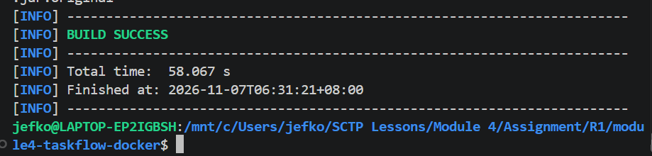 | 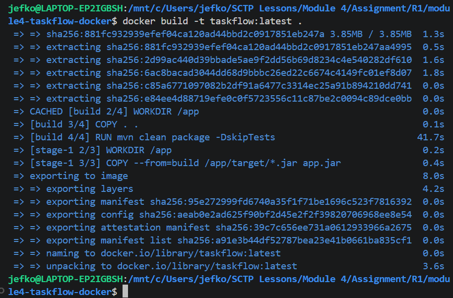 |

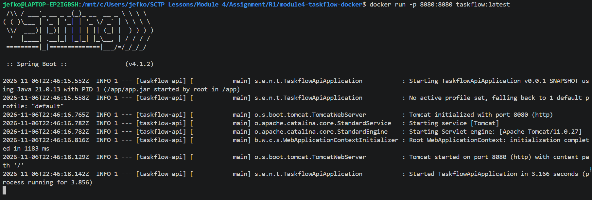
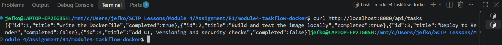

## Task 3 · Deploy to Render

**What:** I created a Render **Web Service** from this GitHub repo (language: Docker, region: Singapore, free plan). Render builds the root `Dockerfile` itself. Settings:

| Setting | Value | Why |
|---|---|---|
| `PORT` | `8080` | Render sends traffic to `$PORT` (default 10000). Spring Boot listens on 8080. |
| Health check path | `/api/tasks` | Render only marks a deploy *Live* when this returns 200. |
| Auto-deploy | **After CI Checks Pass** | A commit that fails tests or security scans never goes live. |
| `CORS_ALLOWED_ORIGINS` | `https://jefkong-taskflow.netlify.app` | Lets the Option 2 frontend call the API. |

**Why:** Render builds directly from git, so every change to `main` that passes CI is redeployed automatically. This is continuous deployment with a quality gate.

**Take note:** On the free plan (0.1 CPU), Spring Boot takes about 55 seconds to start. Render logs `No open ports detected…` until Tomcat is up, then finds port 8080. That message is harmless.

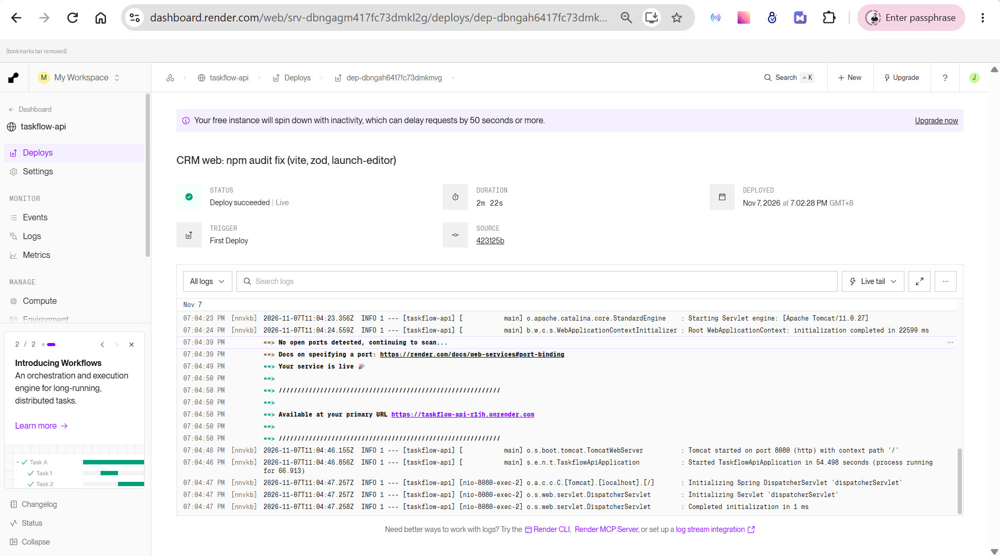

## Task 4 · Verify the deployment

**What:** I called the live endpoint from a browser and with `curl`. Both return the 4 tasks.

**Why:** "Deploy succeeded" in a dashboard only means the container started. A real request proves the app works end to end.

| Browser | curl |
|---|---|
| 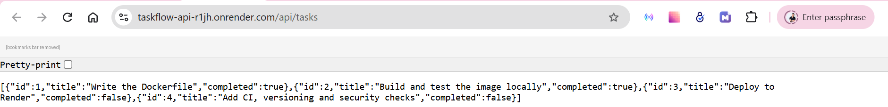 | 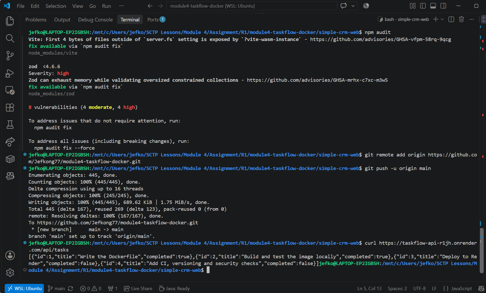 |

**Postman regression run against the live URL.** I re-ran my Module 3 collection ([`docs/postman/TaskFlow.postman_collection.json`](docs/postman/TaskFlow.postman_collection.json)) against Render, using the new [`TaskFlow Live (Render)`](docs/postman/TaskFlow-Live.postman_environment.json) environment, which only changes `baseUrl`. All **24 requests** ran (create, read, update, complete, delete, 404s and 400 validation), and **38 of 38 tests passed, with 0 errors**. The collection creates its own two tasks and deletes them afterwards, so the live data is left as it was.

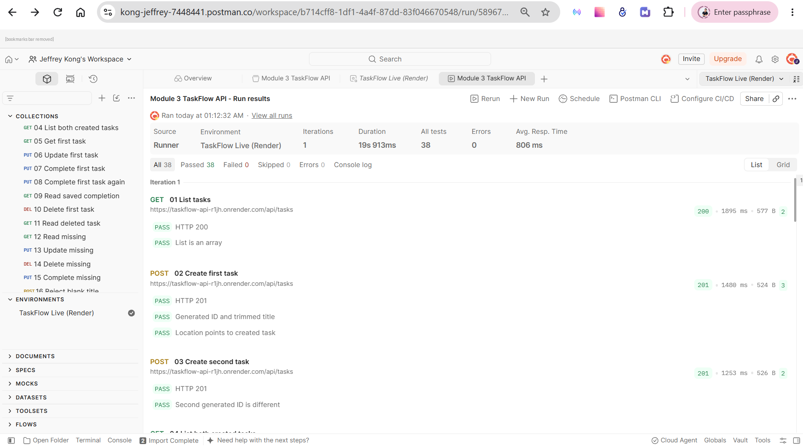

<details>
<summary>All 24 requests in the Postman run (CRUD, 404s, 400 validation)</summary>

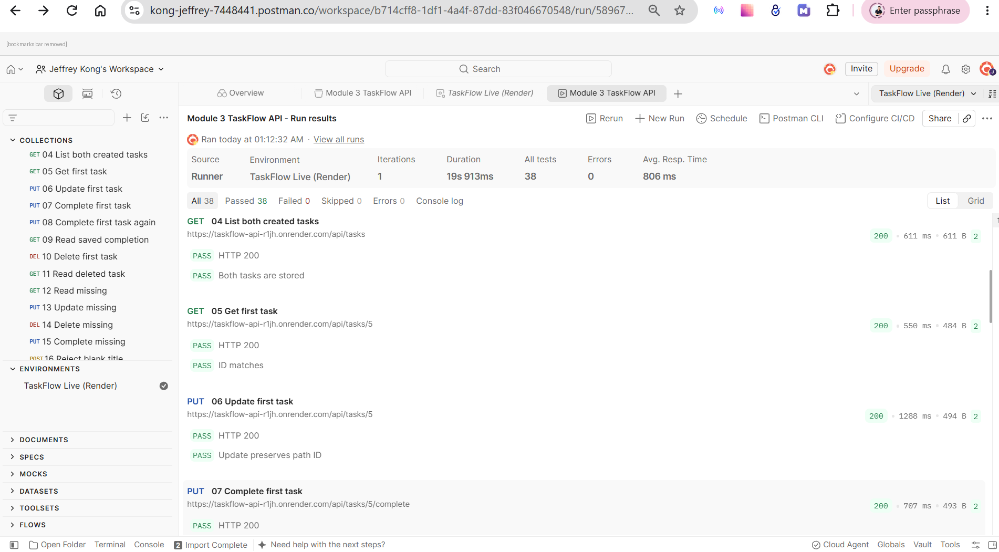
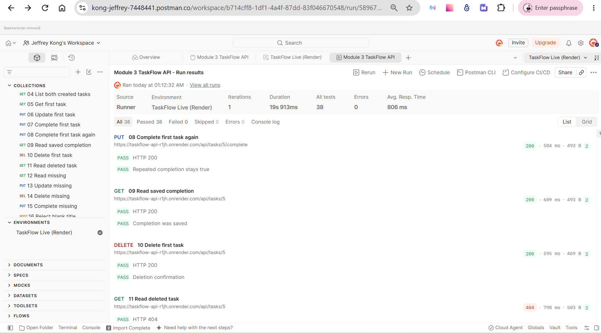
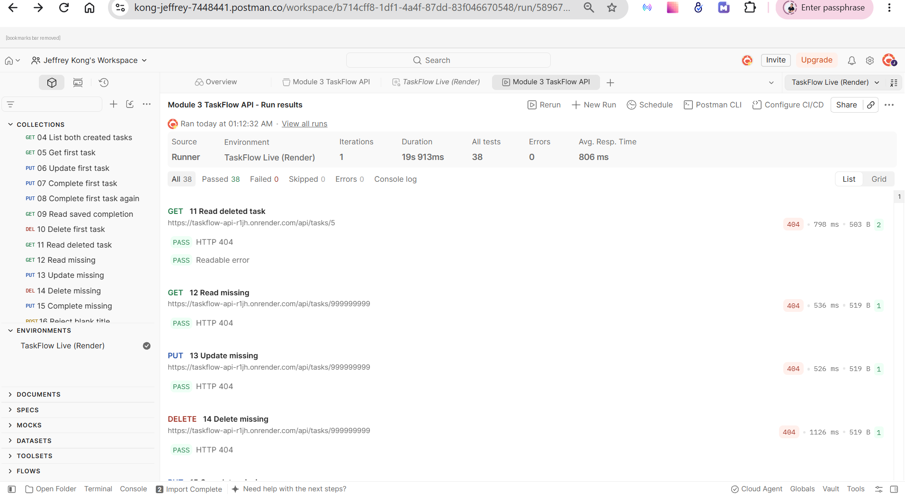
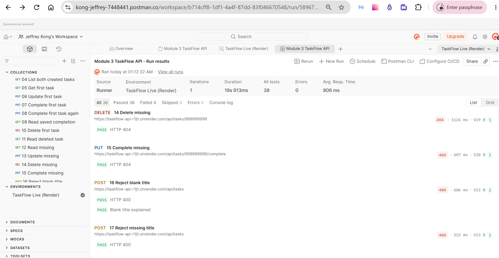
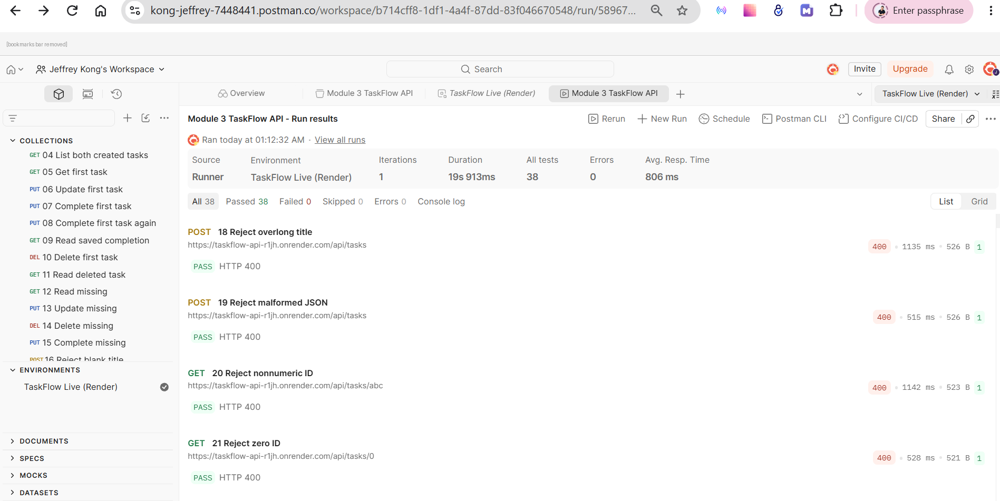
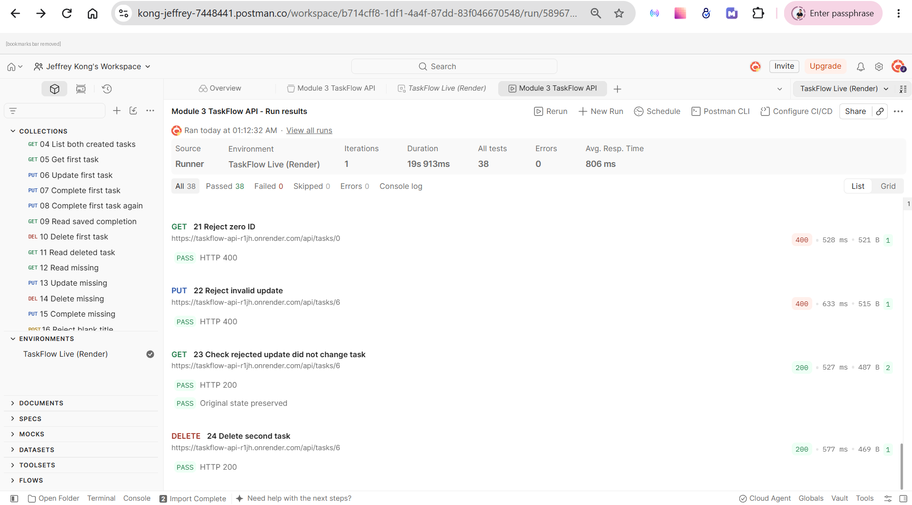
</details>

---

## Stretch goals

### Option 1 · CI pipeline (GitHub Actions → Docker Hub)

**What:** [`.github/workflows/ci.yml`](.github/workflows/ci.yml) runs on every push to `main`, on every `v*.*.*` tag, on pull requests and on demand. Four jobs:

1. **Build and unit test:** `./mvnw verify`, with the test reports kept as an artifact.
2. **Secret scan:** gitleaks across the full git history.
3. **OWASP Dependency-Check:** see [Option 5](#option-5--security-checks).
4. **Build, scan and push image.** This runs only if 1–3 pass. It builds the image, scans it with Trivy, then logs in to Docker Hub and pushes it.

**Why:** Every change gets the same checks automatically, and only images that pass them reach Docker Hub. CI (publishing to Docker Hub) and CD (Render building from git) run **side by side**, as the assignment describes. They're also linked: Render waits for CI to pass.

**Take note:**
- The Docker Hub login uses the GitHub secrets `DOCKERHUB_USERNAME` and `DOCKERHUB_TOKEN`. The token is a **Read & Write** token, not my password, and has **no extra permissions** (least privilege).
- **I didn't use the `aquasecurity/trivy-action` GitHub Action.** In March 2026 attackers hijacked 76 of its 77 version tags to steal CI credentials (CVE-2026-33634). The pipeline instead downloads one fixed Trivy release (`v0.71.2`) and **checks its checksum** before running it.
- With an NVD API key and a cached database, the OWASP job went from 5 minutes 20 seconds on the first run to 40 seconds afterwards.

| Repository secrets (names only; values are never shown) | Successful run on `main` |
|---|---|
| 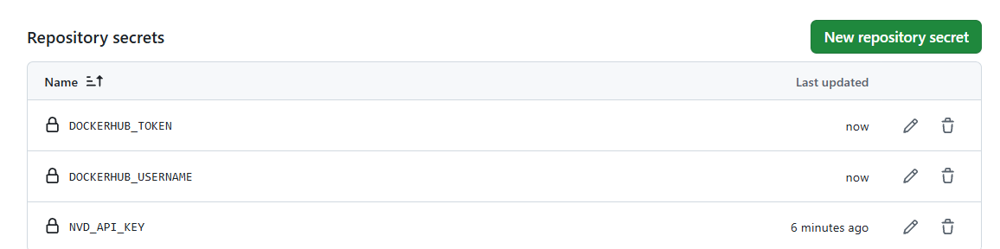 | 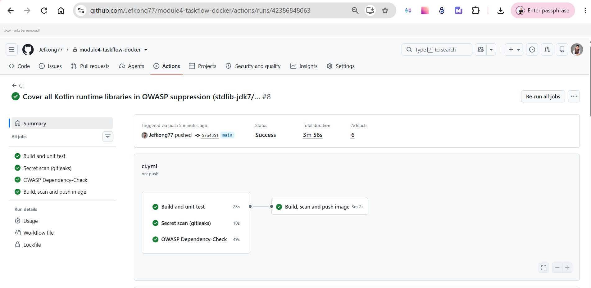 |

### Option 2 · TaskFlow frontend on Netlify

**What:** [`frontend/`](frontend) is a small HTML/CSS/JavaScript page. It lists tasks, adds new ones, marks them complete and deletes them, with live counters and an "API online" indicator. There's no build tool:
- Netlify's build command writes the API address from the `TASKFLOW_API_URL` setting into `config.js`.
- On the API side, [`CorsConfig`](src/main/java/sg/edu/ntu/taskflowapi/config/CorsConfig.java) allows only the origins listed in `CORS_ALLOWED_ORIGINS`.

**Why:** Browsers block a page on `netlify.app` from calling an API on `onrender.com` unless the API explicitly allows that origin (CORS). Reading the allowed list from an environment variable means no URL is hard-coded, and changing it needs no rebuild.

**Take note:**
- Task titles are added to the page as `textContent`, not `innerHTML`. A title containing `` therefore shows as plain text instead of running.
- I tested this, plus the CORS-blocked case, in headless Chrome before deploying.

| Netlify deploy | Frontend showing live API data |
|---|---|
| 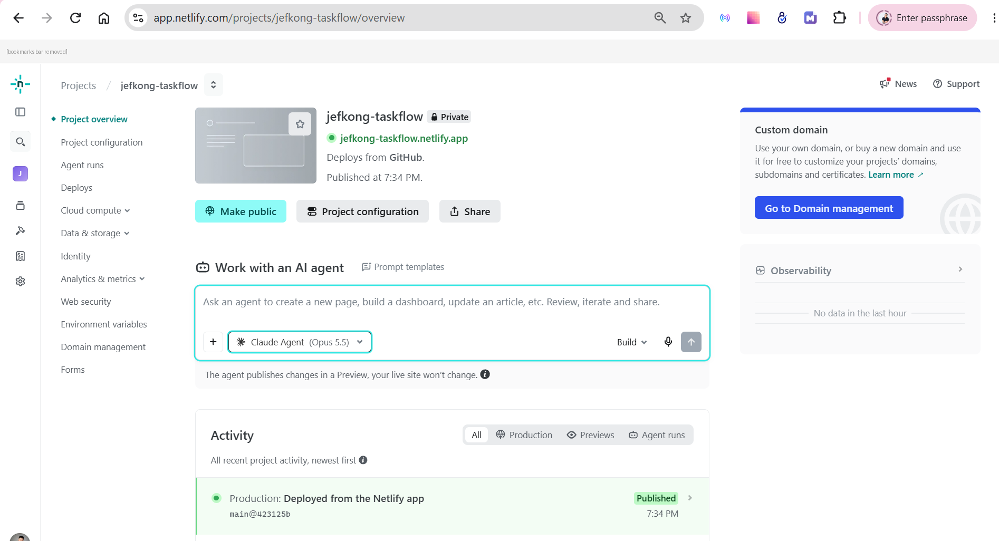 | 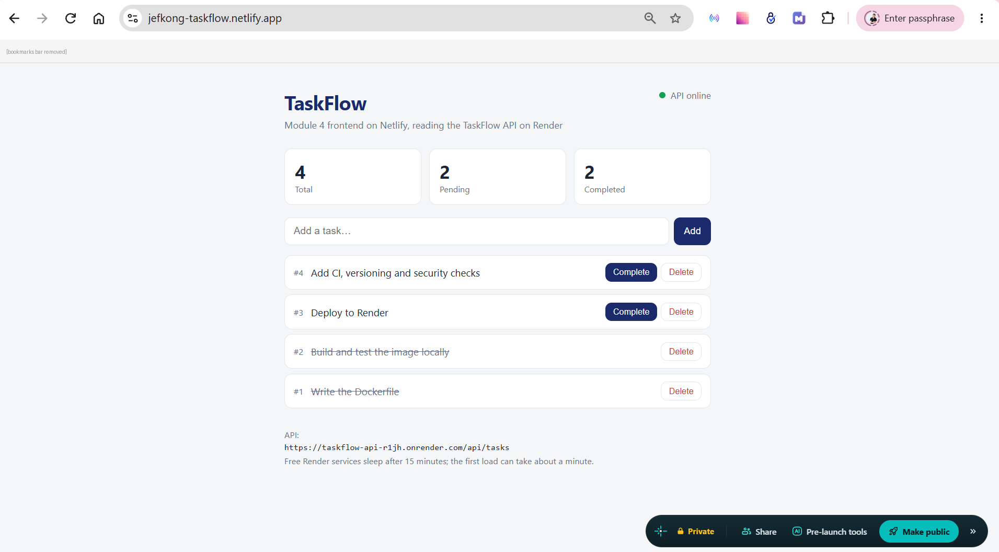 |

### Option 3 · Simple CRM project (Render + PostgreSQL + Netlify)

**What:** In addition to TaskFlow, I containerised the Lesson 4.11 **Simple CRM API** ([`simple-crm-api/`](simple-crm-api)) and deployed it to Render with **PostgreSQL**. I also deployed my Module 2 **Simple CRM React app** ([`simple-crm-web/`](simple-crm-web)) to Netlify, connected to that API.

| Problem | Fix |
|---|---|
| The React app expected json-server fields (`phone`, `status`, `company`, `tags`, `notes`, `createdAt`) and `PATCH` requests. The API had `contactNo`, `jobTitle`, `yearOfBirth` and only `PUT`. | I added the missing fields and a `PATCH` endpoint to the API. `phone` maps to the existing `contactNo` column. The original fields are kept. |
| The React app had `http://localhost:3001` hard-coded | It now reads `VITE_API_BASE_URL`, which is set in Netlify. `netlify.toml` adds an SPA redirect so refreshing `/app/customers` works. |
| Render's free plan allows **one** free Postgres database, already used by my lessons | The app **reuses** that database, but in its own **`module4` schema**, set with `SPRING_APPLICATION_JSON`. The lesson data in `public` is untouched. |
| The API tests needed a running Postgres server | Tests now use an in-memory **H2** database (test scope only), so CI needs no database. |

**Why:** This is the realistic setup: a stateless API container, a managed database reached through **environment variables only** (no credentials in git), and a static frontend on a CDN. Unlike TaskFlow, the CRM data **survives restarts and redeploys**. After the second deploy the log no longer said `Sample data loaded`, because the customers were still there.

**Take note:**
- `SPRING_DATASOURCE_URL` must be in **JDBC** format (`jdbc:postgresql://host:5432/db`). Render's "Internal Database URL" (`postgres://…`) won't work as is.
- `VITE_*` values are **built into the JavaScript at build time**. After changing one on Netlify you must **redeploy**; see error 8 below.
- Adding and deleting customers from Netlify also triggers a browser **CORS preflight** (`OPTIONS`), so `OPTIONS` is in the API's allowed methods.
- Free Render databases expire about 30 days after creation.

| CRM API on Render | `/customers` JSON |
|---|---|
| 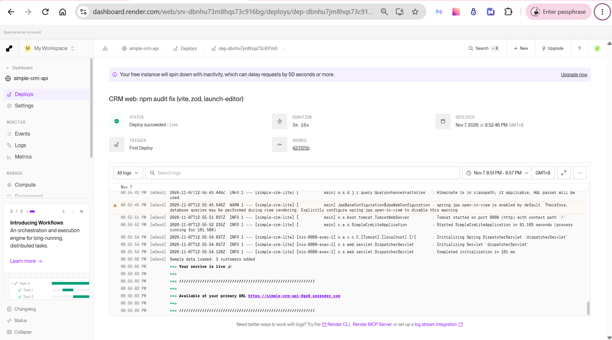 | 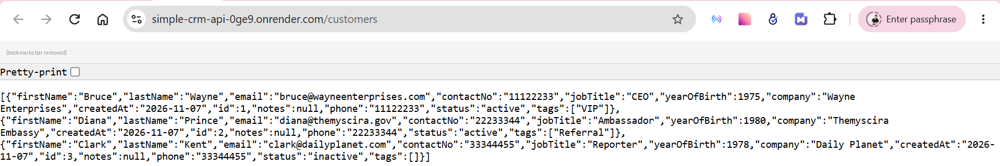 |

| Live CRM app: data from the API | Live add (4 customers) | Live delete (back to 3) |
|---|---|---|
| 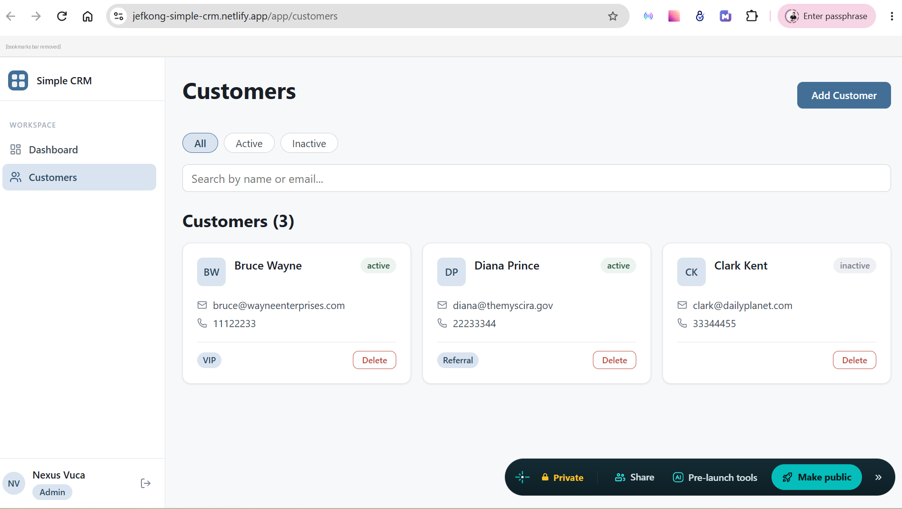 | 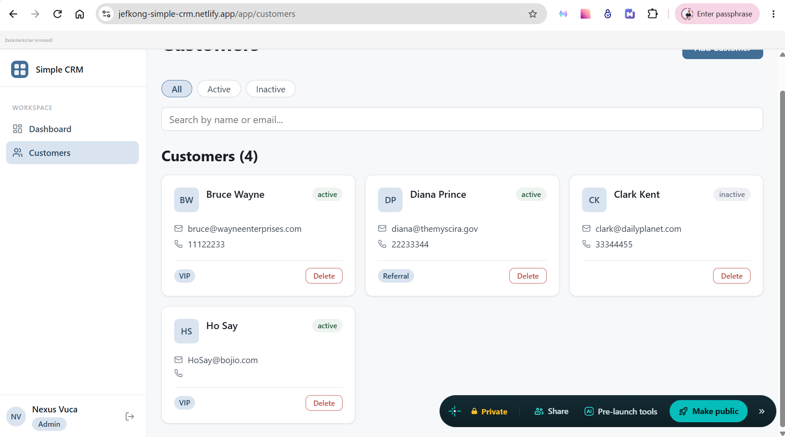 | 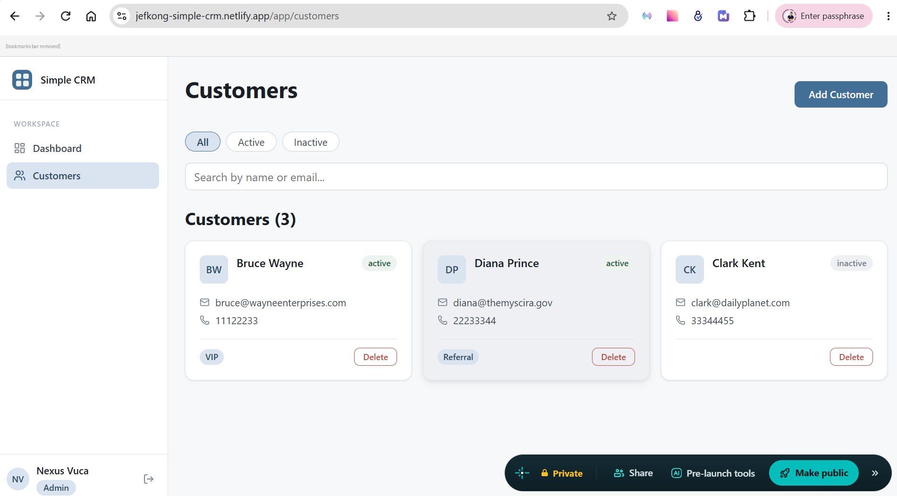 |

<details>
<summary>Local runs of the CRM (Docker Compose + Vite): list, add, edit, delete, tests</summary>

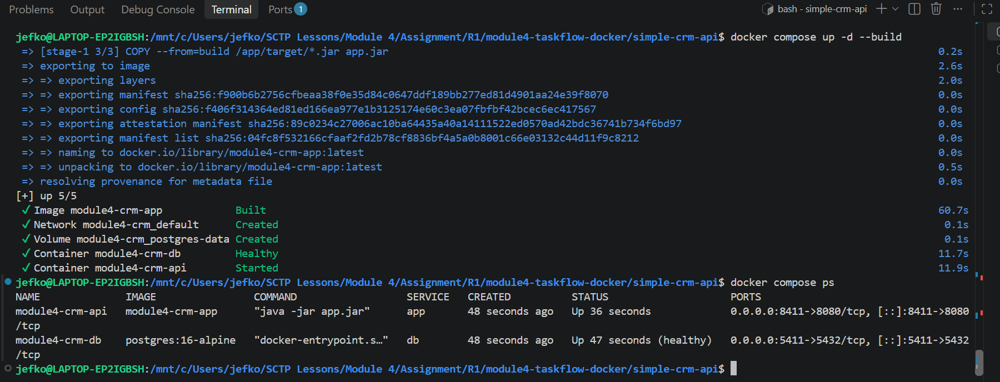
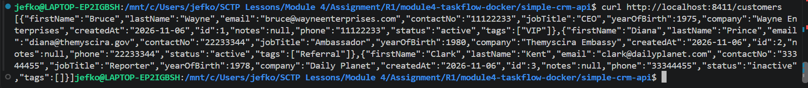
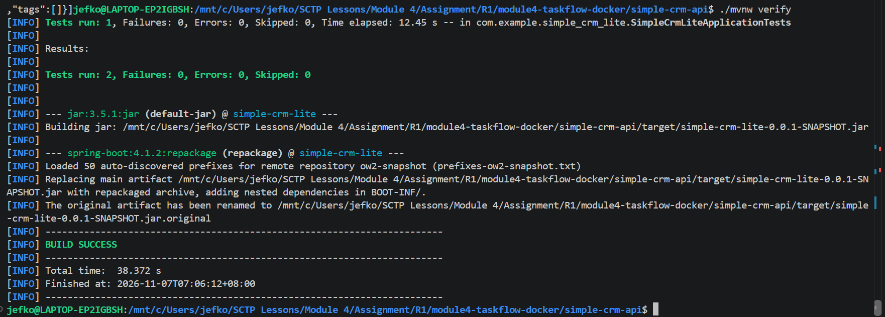
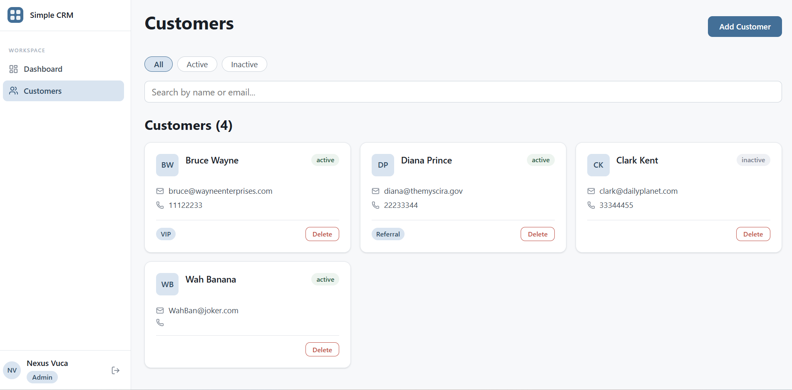
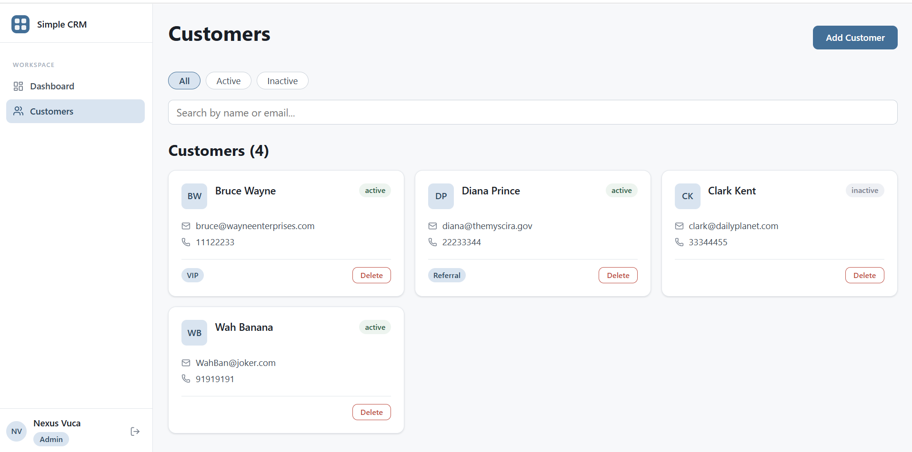
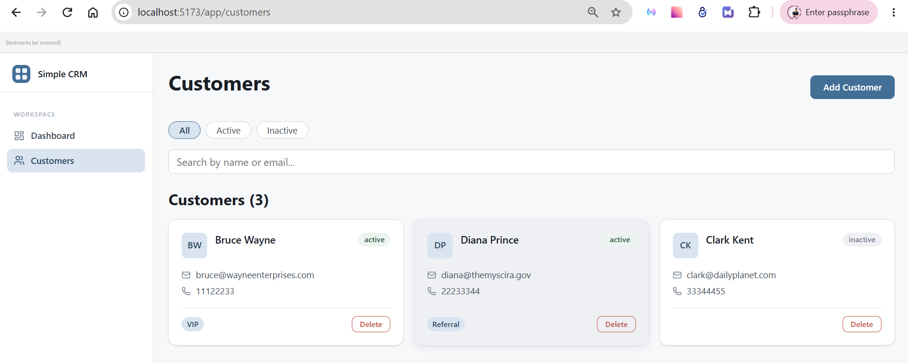
</details>

### Option 4 · Versioned Docker images

**What:** Images are tagged automatically by the CI pipeline, using `docker/metadata-action`:

| Git event | Docker Hub tags |
|---|---|
| `git tag v1.1.2` + push | `1.1.2`, `1.1`, `latest`, `sha-<commit>` |
| Push to `main` | `latest`, `sha-<commit>` |

There are two releases:

| Version | Commit | What changed |
|---|---|---|
| **1.0.0** | `423125b` | First release: the assignment Dockerfile, CORS, CI and both apps |
| **1.1.2** | `57a4851` | Security fixes: zlib patched in the base image, OWASP false positives documented, critical-severity gate enforced |

Git tags `v1.1.0` and `v1.1.1` also exist, but **no image was published for them**. The new OWASP gate correctly **blocked both builds**; see error 11. Published version tags are never moved or reused, so the fix shipped as the next patch number, **1.1.2**. After that I changed the order: push to `main`, wait for green CI, and only then tag.

**Why:** `latest` changes every release, so it can't tell you what's running. **Semantic versioning** (`MAJOR.MINOR.PATCH`) shows how big a change is; 1.0 → 1.1 means new, backward-compatible changes. The **commit SHA** tag traces any image back to the exact source code. Rolling back is just running the previous tag.

**Take note:** `latest` always points to the newest release, as the assignment requires.

| Tags after v1.0.0 | Tags after v1.1.2: both releases, `latest` = 1.1.2 |
|---|---|
| 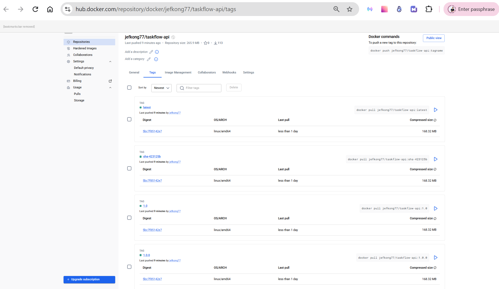 | 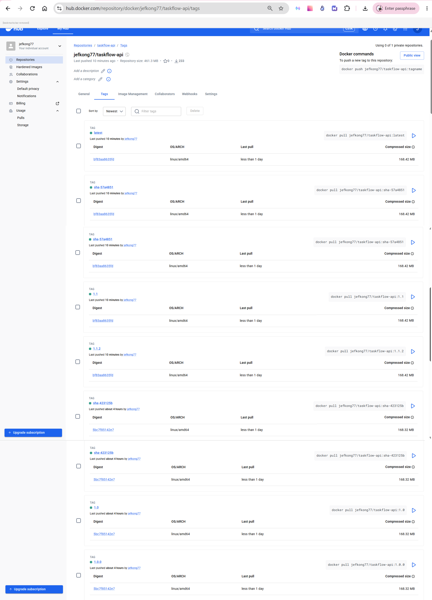 |

The CI build summary shows the four tags generated for one release:

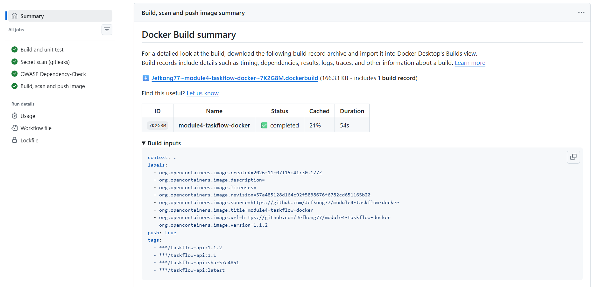

### Option 5 · Security checks

**What:** Four kinds of check, three of them in CI:

| Check | Where | Result |
|---|---|---|
| **gitleaks**: committed secrets | CI, full git history | ✅ **No leaks detected** |
| **OWASP Dependency-Check 12.2.2**: known vulnerabilities in Java libraries (NVD) | CI | 53 libraries scanned, 4 findings, **all false positives on review** (below) |
| **Trivy 0.71.2**: container image scan | CI | `app.jar`: **0**. Base image: **1 MEDIUM**, **fixed in v1.1.2** |
| **npm audit**: CRM React app dependencies | Locally | 8 → **4 moderate**. 4 high fixed; 4 moderate accepted (below) |

**Why:** Most real vulnerabilities come from **dependencies and base images**, not your own code. Scanning on every push catches them early, and secret scanning prevents the most common leak: a key committed by mistake.

#### What the scans found, and what I did

| # | Finding | Severity | Decision |
|---|---|---|---|
| 1 | `zlib` 1.3.2-r1 in the Alpine base image (CVE-2026-4738) | MEDIUM | **Fixed in v1.1.2** with `RUN apk upgrade --no-cache zlib` in the Dockerfile; the fixed version 1.4-r0 was available |
| 2 | `spring-boot-devtools` (CVE-2022-31691) | CRITICAL 9.8 | **False positive.** The CVE affects the Spring Tools **IDE plugins** for Eclipse and VS Code, not this library. Devtools isn't in the final JAR either, and Trivy found the JAR clean. Suppressed. |
| 3 | `kotlin-stdlib`, `-common`, `-jdk7`, `-jdk8`, `kotlin-reflect` (CVE-2026-53914) | CRITICAL 9.8 | **False positive.** The CVE is in the Kotlin **compiler's build cache**. This app only includes the 5 Kotlin runtime libraries, as dependencies of a dependency. All 5 are suppressed by name; the compiler deliberately isn't, so a real compiler issue would still be caught. |
| 4 | `kotlin-stdlib-common` 1.9.10 (CVE-2020-29582) | MEDIUM 5.3 | **False positive.** Fixed in Kotlin 1.4.21 back in 2020; matched only because of an overly broad version range. Suppressed. |
| 5 | `vite`, `zod`, `launch-editor` (npm) | 4 HIGH, moderate | **Fixed** with `npm audit fix`, and the app still builds |
| 6 | `minimatch` via ESLint (npm) | 4 moderate | **Accepted.** ESLint is a development tool that never reaches the browser, and the only fix offered (`--force`) would **downgrade ESLint 10 → 9**. |
| 7 | Demo logins hard-coded in `simple-crm-web/src/data/users.js` | Info | **Accepted for the demo.** It's the Module 2 login, checked in the browser. Anyone can read it with F12, so it uses fake credentials that aren't used anywhere else. A real app would authenticate on the server. |

Suppressions are in [`dependency-check-suppressions.xml`](dependency-check-suppressions.xml). Each has a **written reason** and a **review date (2027-05-01)**, so they get re-checked instead of being forgotten. Since v1.1.x the OWASP job **fails the build on any new CRITICAL finding (CVSS ≥ 9)**, which also stops Render from deploying until someone reviews it. **It worked on day one:** it blocked v1.1.0 and v1.1.1 until every Kotlin library had been reviewed (error 11).

**Take note:**
- **No secrets are in the repo.** Docker Hub, NVD and database credentials exist only as GitHub Secrets and Render or Netlify environment variables.
- The local-only `docker-compose.yml` for the CRM contains the throwaway password `password` for a local Postgres container, as in Lesson 4.11.
- The NVD API key was kept out of all files and screenshots.

| npm audit before the fix | Build after `npm audit fix` | CI v1.1.2: all checks green |
|---|---|---|
| 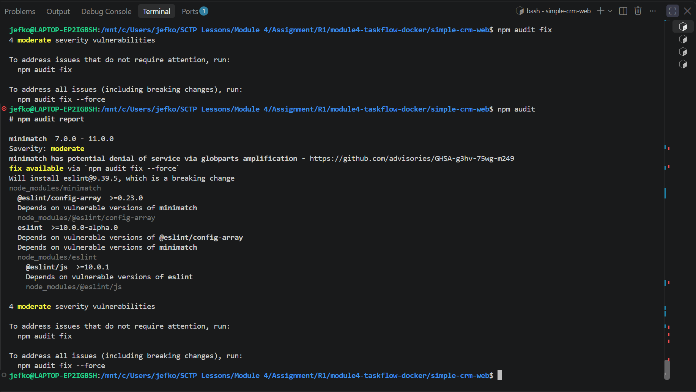 | 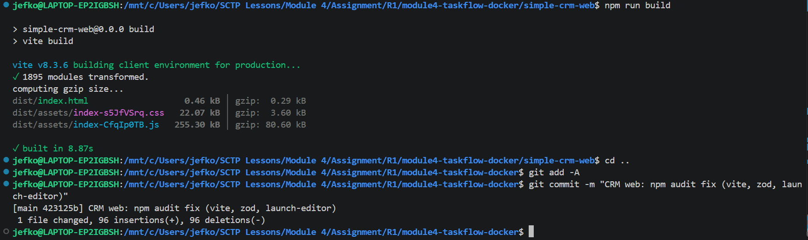 | 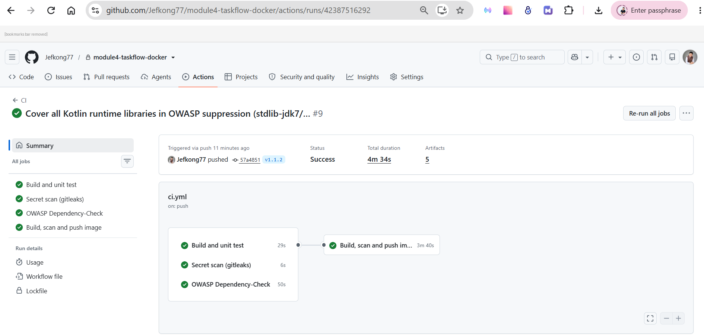 |

---

## Errors and failures (and how I fixed them)

The assignment says failures are part of learning, so here is everything that went wrong:

| # | Error / symptom | Cause | Fix |
|---|---|---|---|
| 1 | `failed to read dockerfile: open Dockerfile: no such file or directory` | The terminal was in my home folder (`~`), not the repo | `cd` into the repo before building |
| 2 | `.mvnw.cmd: command not found` | The terminal was **bash (WSL)**, not PowerShell | Use the bash forms: `./mvnw` and `curl` |
| 3 | `Bind for 0.0.0.0:8080 failed: port is already allocated` | Lesson containers with `restart: unless-stopped` start with Docker Desktop and hold ports 8080 and 8411 | `docker ps`, then `docker stop simple-crm-lite-app lesson-4-11-app` |
| 4 | `git status` showed **137 modified files** I hadn't touched | The repo is on the Windows drive (`/mnt/c`), and WSL saw Windows file permissions as changes | `git config core.fileMode false` |
| 5 | `node: command not found` in WSL | Node was only installed on Windows. Ubuntu's `apt` version is too old for Vite 8. | Installed **nvm** and **Node 22**, the same version Netlify uses |
| 6 | `npm audit fix` → `EACCES … rename` | `npm run dev` had the file open, and Windows won't replace a file that's in use | Stopped the dev server, then reran (8 → 4 moderate) |
| 7 | Edits to `.jsx` files didn't show in the browser | Vite's file watcher doesn't detect changes on `/mnt/c` from WSL | Restarted `npm run dev` |
| 8 | Live CRM app: ``Error: Unexpected token '<', "<!doctype"… is not valid JSON``, and the dashboard showed 0 customers | On Netlify, `VITE_API_BASE_URL`'s **value** was the variable's **name**, so the app requested a Netlify page and got HTML back | Set the value to the Render URL, then **redeployed without cache**, because Vite builds the value in |
| 9 | Pipeline YAML broke after a manual edit (VS Code showed a red `!`) | Pasting changed the indentation inside a `run: >` block | Replaced the file with a checked copy. YAML indentation is part of its structure. |
| 10 | Opening the CRM API's root URL showed a **Whitelabel Error Page (404)** | Not a bug: the API has no page at `/`, only at `/customers` | Use the endpoint path |
| 11 | CI runs #4/#5 (`v1.1.0`) and #6/#7 (`v1.1.1`) failed: `One or more dependencies … CVSS score greater than or equal to '9.0'`, naming `kotlin-reflect`, then `kotlin-stdlib-jdk7` | Dependency-Check **groups related libraries** under `kotlin-stdlib`, so suppressing one made the next one appear. The new gate did its job: **Render didn't deploy** either commit. | Found all 5 Kotlin libraries in the report's `relatedDependencies` and suppressed them by name (CI #8 green). Released as **v1.1.2**, since tags are never reused. |
| 12 | Postman run against the live API: `Error: Request timed out` on the first request, and the run stopped | Render's free service had **gone back to sleep** (more than 15 minutes idle). Waking it takes about 55 seconds, longer than Postman's Cloud Agent waits. | Opened `/api/tasks` in the browser to wake it, then **reran straight away**: 38/38 passed |

---

## Run it yourself

```bash
# TaskFlow API
./mvnw verify
docker build -t taskflow:latest .
docker run -p 8080:8080 taskflow:latest
curl http://localhost:8080/api/tasks

# or pull a released image
docker run -p 8080:8080 jefkong77/taskflow-api:1.1.2

# Simple CRM (API + Postgres) and its React app
cd simple-crm-api && docker compose up -d --build     # API on http://localhost:8411/customers
cd ../simple-crm-web && npm ci
export VITE_API_BASE_URL=http://localhost:8411 && npm run dev   # http://localhost:5173
```

## Repository layout

```
Dockerfile                          Task 1: TaskFlow image (multi-stage)
.dockerignore
.github/workflows/ci.yml            Options 1, 4, 5: test → scan → version → push
dependency-check-suppressions.xml   Option 5: reviewed OWASP false positives
src/                                TaskFlow API (Spring Boot 4, Java 21) + CORS & sample data config
frontend/                           Option 2: TaskFlow UI for Netlify (+ netlify.toml)
simple-crm-api/                     Option 3: Simple CRM API (Spring Boot + PostgreSQL, own Dockerfile & compose)
simple-crm-web/                     Option 3: Simple CRM React app (Vite, + netlify.toml)
screenshots/                        Evidence used in this README
docs/infographic.svg|png            Diagram at the top of this README
docs/module4-runbook.md             Step-by-step commands used for this assignment
docs/MODULE3-README.md              Original Module 3 README (API contract, Module 3 evidence)
docs/postman/                       Module 3 Postman collection + Local and Live (Render) environments
```

## API endpoints (TaskFlow)

| Method | Path | Description |
|---|---|---|
| GET | `/api/tasks` | List all tasks |
| GET | `/api/tasks/{id}` | Get one task |
| POST | `/api/tasks` | Create a task (`{"title": "..."}`) |
| PUT | `/api/tasks/{id}` | Update a task |
| PUT | `/api/tasks/{id}/complete` | Mark a task complete |
| DELETE | `/api/tasks/{id}` | Delete a task |
| GET | `/api/tasks/summary` | AI summary (needs `OPENAI_API_KEY`) |

Full details are in the [Module 3 README](docs/MODULE3-README.md).
